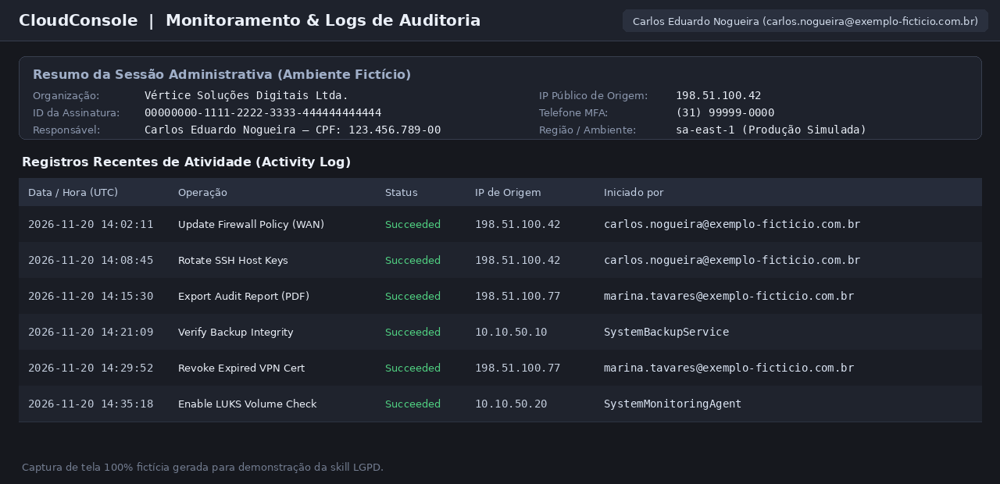
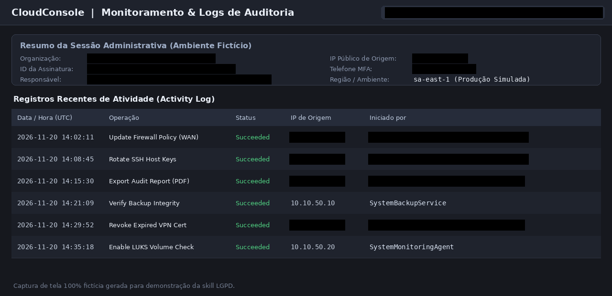

# LGPD — Anonimização e Proteção de Dados Pessoais (Agent Skill)

Skill reutilizável para agentes de IA voltada à identificação, anonimização, pseudonimização e tarjamento definitivo de dados pessoais e dados pessoais sensíveis em conformidade com a **LGPD (Lei nº 13.709/2018)**, preservando o formato e o layout originais do arquivo.

---

## Formatos suportados e estratégia padrão

| Formato | Estratégia padrão | Proteção de metadados |
| :--- | :--- | :--- |
| **PDF** | Tarja preta definitiva + rasterização em alta resolução (180–200 DPI) das páginas alteradas | Limpeza integral (`Author`, `Title`, `Creator`, `Producer`, `Subject`, `Keywords`) |
| **DOCX** | Pseudonimização consistente por rótulos tipados (`[NOME_1]`, `[CPF_1]`, `[EMAIL_1]`) | Limpeza das propriedades do documento |
| **XLSX / CSV** | Substituição apenas dos valores com PII, preservando abas, cabeçalhos e fórmulas | Limpeza das propriedades da pasta de trabalho |
| **TXT / MD / JSON** | Pseudonimização tipada mantendo sintaxe, indentação e chaves intactas | N/A |
| **Imagens / Capturas de tela** | Inspeção e tarjamento preto irreversível em PII visível (nomes, e-mails, CPF, IPs públicos, IDs de assinatura) | Removidos na exportação |

---

## Demonstração visual (dados 100% fictícios)

### Antes da anonimização


### Depois da anonimização


Os exemplos completos em PDF (`examples/exemplo_antes.pdf` e `examples/exemplo_depois.pdf`) demonstram a sanitização combinada de **texto + captura de tela embutida**, com remoção definitiva da camada de texto selecionável e limpeza integral de metadados.

---

## Estrutura do repositório

```text
lgpd-anonimizacao-skill/
├── SKILL.md
├── README.md
├── LICENSE
└── examples/
    ├── exemplo_antes.pdf          # Relatório fictício com texto + imagem embutida
    ├── exemplo_depois.pdf         # Versão sanitizada (texto, imagem e metadados)
    ├── exemplo_imagem_antes.png   # Captura de tela fictícia isolada
    └── exemplo_imagem_depois.png  # Captura de tela sanitizada
```

---

## Aviso de responsabilidade

Esta skill é um recurso técnico de apoio à privacidade e à adequação operacional à LGPD. Ela não substitui revisão jurídica, avaliação do Encarregado de Dados (DPO) ou validação humana final antes da divulgação pública de documentos.

## Licença

Distribuído sob a licença **MIT**. Consulte o arquivo `LICENSE` para mais detalhes.
